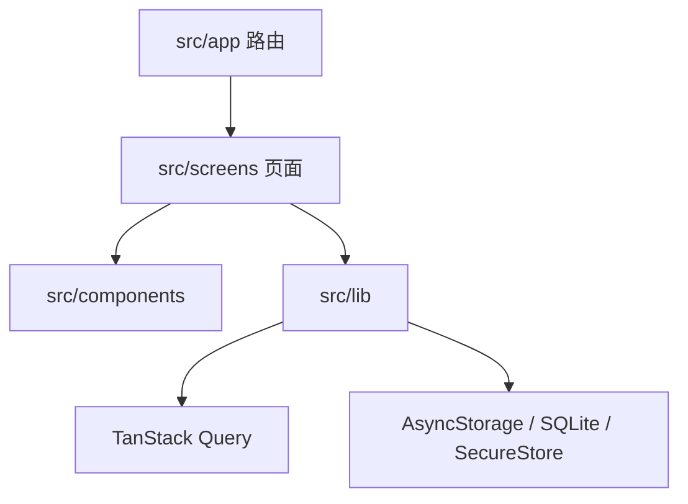

# 正式 Expo 工程布局

仓库根目录就是 Expo 工程根。技术栈按 [hiduck/doc/react-native-expo-learning-guide.md](hiduck/doc/react-native-expo-learning-guide.md) 的正式路线：TypeScript、Expo SDK 57、Expo Router、`StyleSheet`，数据用 `fetch`、TanStack Query、AsyncStorage、`expo-sqlite`、`expo-secure-store`。现有 [StickerSmash](StickerSmash) 已是 SDK 57 和 `expo-router`，把它提升到根目录，教程子目录不再保留。

[hiduck](hiduck) 继续放规则和文档，不参与打包。根目录 [AGENTS.md](AGENTS.md) 保持不动，不拿 `StickerSmash/AGENTS.md` 覆盖。

## 提升到仓库根

从 `StickerSmash` 拿到根目录的只有工程文件：`package.json`、`package-lock.json`、`app.json`、`tsconfig.json`、`assets/`、现有 `src/`、`.gitignore`。`node_modules`、`.expo`、`example/` 不搬，提升后在根目录重新 `npm install`。

根目录 [.vscode/settings.json](.vscode/settings.json) 保留现有格式化配置，并补上 `StickerSmash` 里的 `editor.codeActionsOnSave`。`StickerSmash/.claude` 不合并。

## 源码分层

这是正式工程的固定分层，一次摆齐。依据是 SDK 55+ 默认模板的 `src` 目录，以及 [Expo 目录实践](https://expo.dev/blog/expo-app-folder-structure-best-practices) 里的 screens / components / hooks 分界。指南里的数据能力放进 `src/lib`，不另做服务端。当前栈没有 Expo API Routes，所以不建 `src/app/api` 和 `src/server`。

```text
/
  app.json
  eas.json
  package.json                 # "main": "expo-router/entry"
  tsconfig.json                # "@/*": ["./src/*"]
  assets/
  src/
    app/
      _layout.tsx              # Safe Area、QueryClient、主题
      +not-found.tsx
      (tabs)/
        _layout.tsx
        index.tsx              # 只渲染 HomeScreen
      notes/
        [id].tsx               # 只读取路由参数并渲染详情屏
    screens/
      home/
        index.tsx
      note-detail/
        index.tsx
    components/
      note-card.tsx
    hooks/
      use-tablet.ts            # width >= 768
    constants/
      theme.ts
    lib/
      api/
        client.ts              # fetch
      query/
        client.ts              # QueryClient
      storage/
        async-storage.ts
        sqlite.ts
        secure-store.ts        # token 只走这里
    types/
      note.ts
    utils/
  hiduck/
```

`src/app` 里只放路由。页面组合放 `src/screens`，可复用 UI 放 `src/components`，请求、缓存和本地存储放 `src/lib`。路由文件不写列表、存储和请求逻辑。



文件名用 kebab-case。路由文件保持 Expo Router 约定：`_layout.tsx`、`index.tsx`、`[id].tsx`、`+not-found.tsx`。样式写在组件文件底部的 `StyleSheet.create`。平台差异大时用 `*.android.tsx`、`*.ios.tsx`、`*.web.tsx`。

平板断点集中在 `use-tablet.ts`：`useWindowDimensions()`，`width >= 768` 时改列数、间距和导航。

## 工程配置

`eas.json` 放三个 profile：`development`、`preview`、`production`。图标和启动图继续用根目录 `assets/`，沿用提升上来的 `app.json`。不生成 `ios/` 和 `android/`，这两项目录已在 `.gitignore` 里。

这次只建立目录、路由壳和数据入口，不实现笔记的增删改查。
