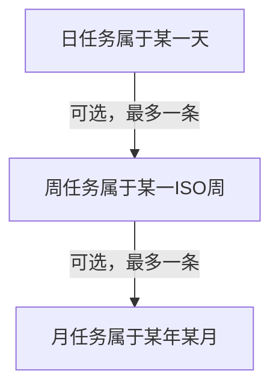

# 三级待办

用现有的 Expo Router、SQLite 和 TanStack Query，把笔记占位换成待办。每条任务自己勾选完成，完成数只统计被引用的子任务。`app.json` 里的应用名保持不动。

## 引用规则

- 月任务没有上级。周任务只能引用该周周一到周日所覆盖月份里的月任务；一周跨两个月时，两个月的月任务都可以选。日任务只能引用该日所在 ISO 周的周任务。
- 不引用也能单独存在。日任务不能引用月任务。
- 删除上级时，下级保留，只清空 `parent_id`。

## 数据

在 [src/lib/storage/sqlite.ts](src/lib/storage/sqlite.ts) 首次打开 `notebook.db` 时建表 `tasks`：`id`、`level`（`month` | `week` | `day`）、`period_key`、`title`、`done`、`parent_id`、`created_at`。

`period_key` 用本地日期，不新增日期库：

- 月：`2026-10`
- 周：`2026-W44`（周一为一周开始）
- 日：`2026-10-28`

写入时在 [src/lib/tasks/db.ts](src/lib/tasks/db.ts) 拒绝跨级或周期不匹配的 `parent_id`。进度在查询时算出，不另存：

- 月任务：直接引用它的周任务总数和已完成数；这些周任务下面的日任务总数和已完成数。
- 周任务：直接引用它的日任务总数和已完成数。

## 界面

三个 Tab：月、周、日。Tab 布局里放一个共享的当前日期，上一档/下一档按当前 Tab 移动一个月、一周或一天，切换 Tab 时仍对应该日期。

列表行显示标题、完成勾选，以及进度文案。月任务为「周 2/5 · 日 3/8」，周任务为「日 1/4」。点行进入详情。

详情可改标题、勾选完成、选择或清除上级、删除。月任务详情列出被引用的周任务（每条带自己的日进度）和这些周下面的日任务。周任务详情列出被引用的日任务。新建任务写入当前 Tab 对应的周期，标题必填，上级可选。

沿用 [src/constants/theme.ts](src/constants/theme.ts) 的颜色，路由文件只取参数并渲染 screen。

## 替换范围

删除笔记占位：[src/screens/home/index.tsx](src/screens/home/index.tsx)、[src/screens/note-detail/index.tsx](src/screens/note-detail/index.tsx)、[src/components/note-card.tsx](src/components/note-card.tsx)、[src/types/note.ts](src/types/note.ts)、[src/app/notes/[id].tsx](src/app/notes/[id].tsx)。Tab 从「笔记」改为月、周、日。

主要新增：[src/types/task.ts](src/types/task.ts)、[src/lib/tasks/period.ts](src/lib/tasks/period.ts)、[src/lib/tasks/db.ts](src/lib/tasks/db.ts)、[src/lib/tasks/queries.ts](src/lib/tasks/queries.ts)、[src/screens/task-list/index.tsx](src/screens/task-list/index.tsx)、[src/screens/task-detail/index.tsx](src/screens/task-detail/index.tsx)、[src/app/(tabs)/week.tsx](src/app/(tabs)/week.tsx)、[src/app/(tabs)/day.tsx](src/app/(tabs)/day.tsx)、[src/app/tasks/new.tsx](src/app/tasks/new.tsx)、[src/app/tasks/[id].tsx](src/app/tasks/[id].tsx)。
